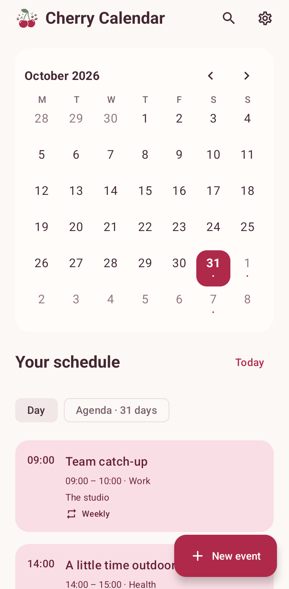
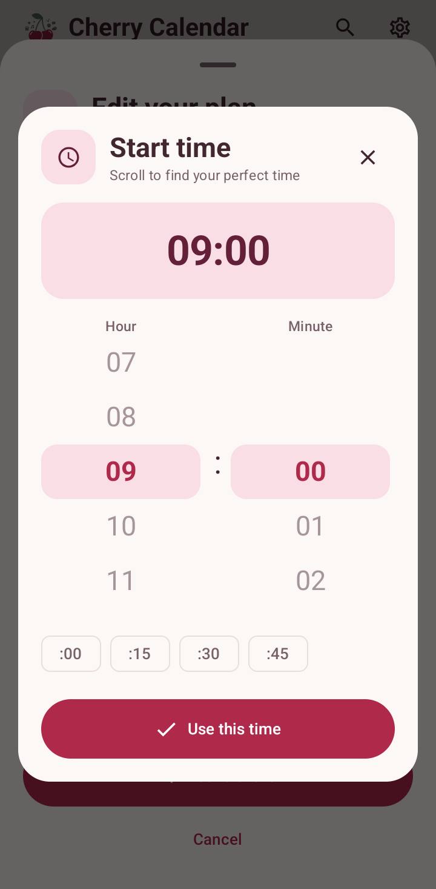
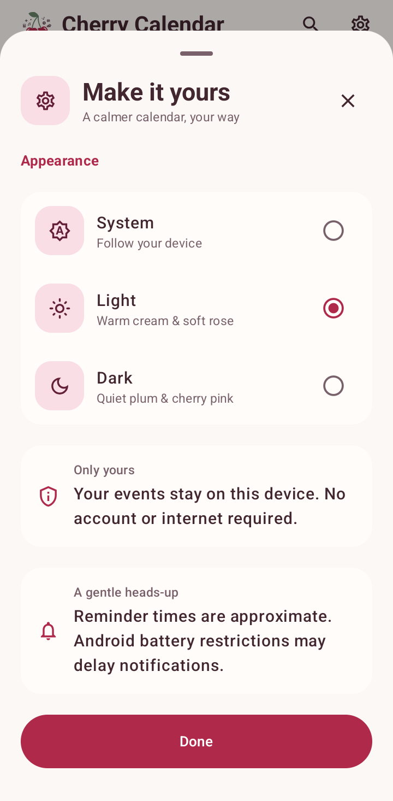

<div align="center">
  
  <h1>Cherry Calendar</h1>
  <p><strong>Make room for a good day.</strong></p>
  <p>A calm, offline calendar for your plans, everyday events, and gentle reminders.</p>
  <p>
    
    
    
  </p>
  <p>
    <a href="https://github.com/asta-JC/Cherry-Calendar/releases/download/v1.1.2/Cherry-Calendar_v1.1.2.apk"><strong>Download APK · v1.1.2</strong></a> ·
    <a href="https://github.com/asta-JC/Cherry-Calendar/releases/tag/v1.1.2">Release notes</a>
  </p>
  <p>
    <a href="#screenshots">Screenshots</a> ·
    <a href="#features">Features</a> ·
    <a href="#getting-started">Get started</a> ·
    <a href="https://github.com/asta-JC/Cherry-Calendar/issues">Feedback</a>
  </p>
</div>

---

## Overview

Cherry Calendar brings your month, daily schedule, and upcoming plans into one warm cherry space. Add an event, choose its time, and set a reminder without creating an account. Cream and rose surfaces in Light mode and quiet plum surfaces in Dark mode keep the focus on your day.

## Screenshots

<table>
  <tr><th width="33%">Your calendar</th><th width="33%">Find your time</th><th width="33%">Make it yours</th></tr>
  <tr>
    <td align="center"></td>
    <td align="center"></td>
    <td align="center"></td>
  </tr>
  <tr><td align="center">A month of possibilities.</td><td align="center">Scroll, choose, and confirm.</td><td align="center">Choose your everyday colors.</td></tr>
</table>

Captured in Light mode on a physical Samsung Galaxy S22 Ultra (SM-S908N), Android 16. Events are in-memory demonstration data rendered by the production screens; personal events and system notification chrome are not shown.

## Features

- **Your schedule:** browse months, select a day, or view the next 31 days in the agenda.
- **Plans with context:** create, edit, and delete events with all-day options, categories, locations, and notes.
- **Comfortable time selection:** custom date shortcuts, year navigation, snapping hour/minute wheels, exact minutes, and 12/24-hour display following your device.
- **Repeats and reminders:** daily, weekly, monthly, and yearly events with configurable notification reminders.
- **Find it again:** search event titles, places, and notes; Back returns from search to the calendar.
- **A quieter interface:** saved System/Light/Dark appearance, accessible action icons, fixed editor actions, and sheets that dismiss from their top handle while their content scrolls independently.

## Compatibility

| Area | Current behavior |
| :--- | :--- |
| Android | Android 7.0 / API 24 minimum; targets API 37. Physically verified on Android 16. |
| Storage | Events are saved in the app's local SQLite database. No Google Calendar or device-calendar sync. |
| Event times | Timed events start and end on the same day; all-day events are supported. |
| Recurrence | Daily, weekly, monthly, yearly. Month-end repeats use the last valid day of shorter months. Editing or deleting affects the entire repeating event. |
| Notifications | Require notification permission on Android 13+. Reminders are approximate and may be delayed by Android battery restrictions. |
| Appearance | System, Light, and Dark; the selected override is saved. |

## Getting started

### Download

Install [Cherry-Calendar_v1.1.2.apk](https://github.com/asta-JC/Cherry-Calendar/releases/download/v1.1.2/Cherry-Calendar_v1.1.2.apk) from [GitHub Releases](https://github.com/asta-JC/Cherry-Calendar/releases/tag/v1.1.2). The release includes `SHA256SUMS.txt`.

This APK uses the existing **debug/test signing certificate**, not a separate production signing key.

### Requirements

- Android Studio compatible with the pinned Android Gradle Plugin 9.4.1 and Gradle 9.6.0.
- Android SDK 37 and JDK 25 (the version pinned by the Gradle daemon toolchain).
- A physical Android device for running and device tests.

### Build and run

```bash
git clone https://github.com/asta-JC/Cherry-Calendar.git
cd Cherry-Calendar
./gradlew :app:assembleDebug
```

The APK is written to `app/build/outputs/apk/debug/app-debug.apk`. Run from Android Studio or install without clearing existing app data:

```bash
adb -s YOUR_DEVICE_SERIAL install -r app/build/outputs/apk/debug/app-debug.apk
```

### Tests

```bash
./gradlew :app:testDebugUnitTest :app:lintDebug
ANDROID_SERIAL=YOUR_DEVICE_SERIAL ./gradlew :app:connectedDebugAndroidTest
```

Unit tests cover recurrence, month ends, leap years, daylight-saving changes, and reminder scheduling. Physical-device checks cover event storage/editing/deletion, custom pickers, draft restoration, appearance, search Back, keyboard scrolling, and sheet gestures. The README capture test uses an in-memory event source and restores the saved appearance.

## Built with

| Layer | Technology |
| :--- | :--- |
| Interface | Kotlin, Jetpack Compose, Material 3, Material Icons |
| Local events | Android SQLiteOpenHelper |
| Reminders | AlarmManager, BroadcastReceiver, Android notifications |
| Dates and background work | java.time with desugaring; Kotlin coroutines |
| Appearance | CherryApps semantic palette and SharedPreferences |
| Verification | JUnit, Compose UI tests, Espresso, Android lint |

## What's new in 1.1.2

- Cherry-styled event editor, details, settings, and custom date/time controls.
- Supplied calendar launcher icon with adaptive and monochrome variants.
- Search Back navigation returns to the calendar.
- Top handles dismiss sheets; holding the grip stays visually quiet, and fast content flings no longer pull sheets down and back up.

## Feedback

[Open an issue](https://github.com/asta-JC/Cherry-Calendar/issues) with your device model, Android version, app version, and steps to reproduce. Include a non-sensitive screenshot or sample event when useful.

## License & credits

No standalone license file is currently included in this repository. App branding and development are by Asta. Kotlin, AndroidX, Jetpack Compose, and Material Icons retain their respective authorship and license notices.

---

<p align="center">
  <strong>Made with ❤️ &amp; 🍒 by Asta</strong><br />
  <sub>Part of the CherryApp family.</sub>
</p>
